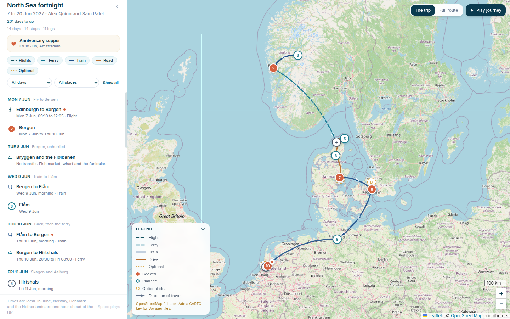
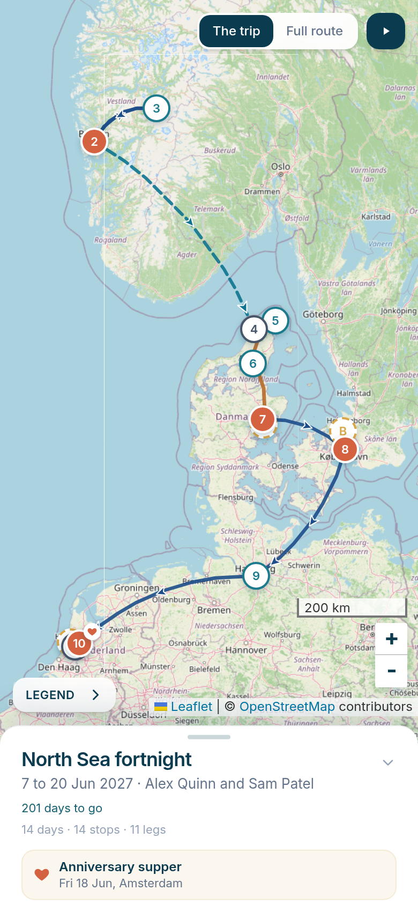
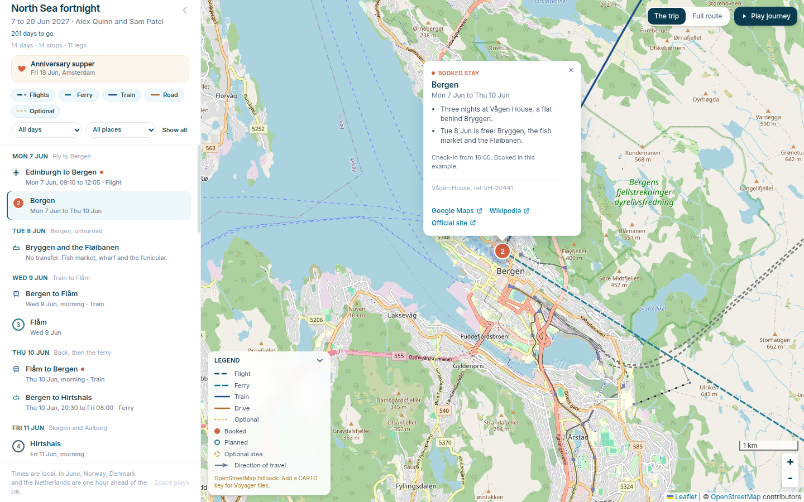

# journey-map-skill

An agent skill that turns a free-text trip description into a day-by-day itinerary and a single interactive HTML journey map.

You paste a rough plan. The skill asks one short batch of questions about anything that is still ambiguous, drafts an itinerary for you to confirm, then fills a template. The result is one HTML file you can open in a browser. No build, no account, no server.

The route lines are curved to match the Mercator tiles, with an arrowhead for direction. Colour and dash follow the mode: flight, ferry, train, road, or an optional idea. Click a place for notes and links (Google Maps, Wikipedia, an official site). Filters narrow the map by transport, day, or kind of place. The trip view hides the home airport. Full route brings it back. Play journey steps through the legs.

A place popup, with links out:

## Try the example

Open [`examples/north-sea-fortnight.html`](examples/north-sea-fortnight.html) in a browser. It is a fictional two-week trip: a flight from Edinburgh to Bergen, the train to Flåm, an overnight ferry to Denmark, a drive down the coast, then trains to Copenhagen and, via Hamburg, to Amsterdam.

The people, dates, and booking references are invented. Nothing in the example is a real reservation.

- The note that started it: [`examples/example-prompt.md`](examples/example-prompt.md)
- The itinerary after one round of questions: [`examples/example-itinerary.md`](examples/example-itinerary.md)

On the map, Space starts and pauses the tour. The arrow keys step through legs. Escape closes it.

## Use the skill

The instructions live in [`SKILL.md`](SKILL.md). The blank map lives in [`template/journey-map.html`](template/journey-map.html). Keep those two together: the skill tells the agent to copy the template and replace only the `TRIP` object near the top of the file.

**Claude, and other Anthropic-style skills.** Put this folder where you keep skills, so `SKILL.md` sits next to `template/`. Claude Code reads a skill from `.claude/skills/journey-map/` (or your user skills directory) when the description matches.

**Cursor.** Add the folder as a project skill, or point a rule at `SKILL.md`, and leave `template/journey-map.html` in the project so the agent can read it.

**ChatGPT, or any other chat model.** Paste the body of `SKILL.md` into the custom instructions (or attach it), and attach `template/journey-map.html` in the conversation when you ask for the map. The model only has to fill the data block.

In every case the agent should ask about real gaps, show you a Markdown itinerary, and wait for a yes before it writes the HTML.

## Tiles

CARTO Voyager, the quieter basemap these maps were designed around, now needs a free API key. The template supports that without a code change:

- Set `cartoApiKey` inside the `TRIP` object, or
- Open the file once with `?cartoKey=YOUR_KEY` on the URL. The page stores it in that browser.

With no key, the map uses standard OpenStreetMap tiles and the legend says so. Either way the corner credit stays accurate: OpenStreetMap contributors, plus CARTO when Voyager is actually in use.

The key request page is [carto.com/basemaps](https://carto.com/basemaps).

Fonts, Tailwind, and Leaflet are loaded from CDNs, so the file needs a network connection the first time you open it. The trip itself is all in the file.

## Layout

| Path | What it is |
| --- | --- |
| `SKILL.md` | The instructions an agent follows |
| `template/journey-map.html` | The map, with a placeholder trip in `TRIP` |
| `examples/` | A fictional prompt, the itinerary, and the generated map |
| `docs/` | Screenshots of the example |

## Contributing

Issues and pull requests are welcome. Bug fixes, another transport mode, and clearer copy are all in scope.

Please keep a few habits:

- Trip facts belong in the `TRIP` object. The rest of the HTML is the engine, shared by every map.
- `examples/north-sea-fortnight.html` is the template with a filled `TRIP`. If you change the engine, change it in both files.
- Do not commit real booking references, private addresses, emails, or phone numbers. The `uploads/` folder is gitignored for that reason.
- The example travellers are fictional. Leave them fictional.

## Licence

[MIT](LICENSE).
